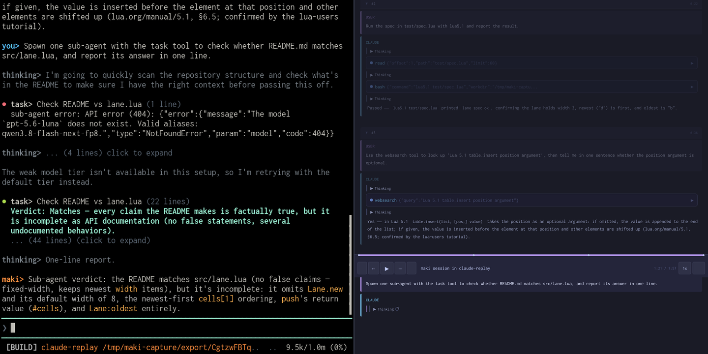
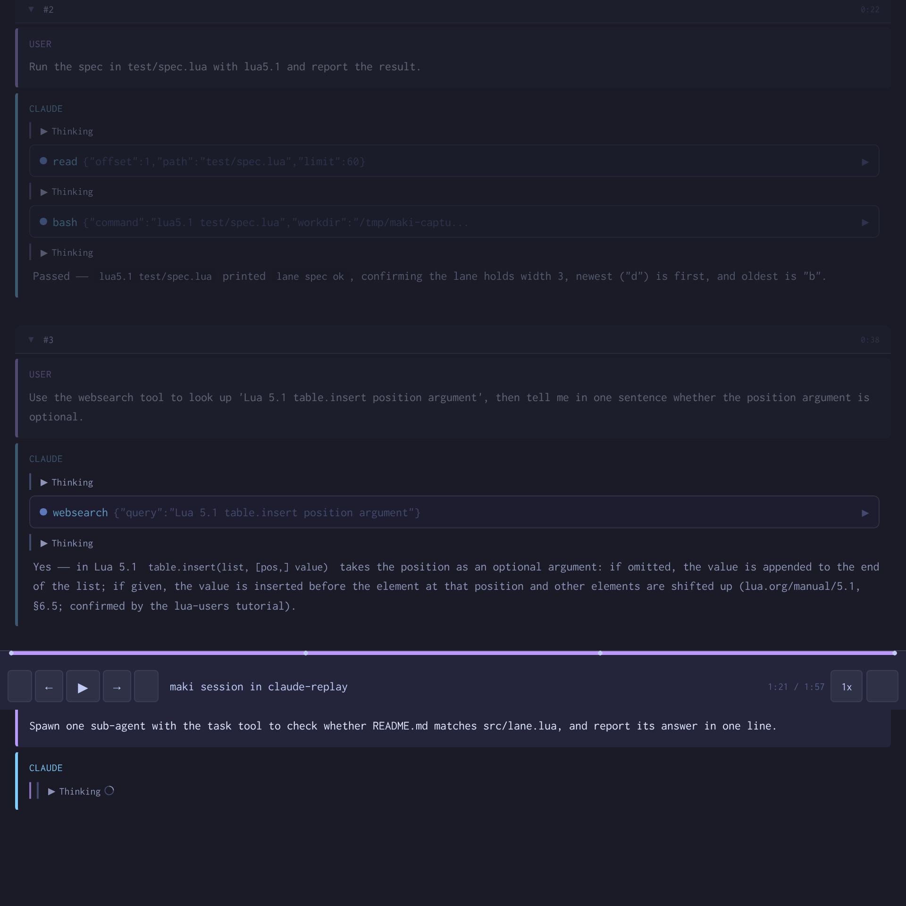

# replay



`/replay` writes a maki session out as Claude Code JSONL, the format
[claude-replay](https://github.com/es617/claude-replay) reads. You get one file
for the main conversation and one per sub-agent, plus the command that turns
them into HTML. The cover above is both ends of that: the terminal on the left, the
web player on the right, from one session.

## Install

Put this line in your global `~/.config/maki/init.lua`:

```lua
maki.pack.add({ "https://github.com/g4bwy/maki-replay" })
```

Start maki in a terminal. It asks whether to install the package, then asks
about the permissions in [`plugin.toml`](plugin.toml). Maki writes the installed
commit to `pack-lock.json` in your config directory.

## Usage

```text
/replay                       export the session you are in to the current directory
/replay <session-id>          export one session by id or id prefix
/replay <session-id> <dir>    write the files somewhere else
```

The plugin prints the converter command when it finishes:

```sh
claude-replay <dir>/<id>.jsonl <dir>/<sub-agent files> -o out.html
```

## The web replay

[claude-replay](https://github.com/es617/claude-replay) is a Node CLI with no runtime
dependencies, so one local install is enough:

```sh
npm install --prefix /tmp/replay-tool claude-replay
/tmp/replay-tool/node_modules/.bin/claude-replay <dir>/<id>.jsonl -o out.html
```

Open `out.html` in a browser. It is one self-contained file, so you can mail it or
commit it, and the player turns the session into a timeline you can step through,
play, and change speed on.

Below, the same session the left half of the cover shows, opened in the player: a
prompt, its collapsed `read` and `bash` calls, then a `websearch` call and the answer
it produced, with the timeline and transport between them.



The export above came from a session recorded for this package's terminal cover, so the
page shows invented demo work on a small Lua queue, not anybody's real project.

## Large sessions

A long session passes 1 GiB, and Lua cannot hold a file that big in one string.
The plugin therefore reads a big session in 8 MiB windows with `dd`, `base64`,
and `tr`, and writes the output in batches. It keeps only the main conversation
in memory and re-reads each file to stream the sub-agents.

Put `dd`, `base64`, and `tr` on `PATH` for sessions over 64 MiB. Without them
the plugin falls back to one whole read. That fails past 1 GiB with an error in
the status bar rather than a crash. See
[docs/read-limit.md](docs/read-limit.md) for the failure this design avoids.

## Permissions

| Key | Used by |
|-----|---------|
| `fs_read` | `maki.env.state_dir()`, `maki.fs.read()`, `maki.fs.dir()`, `maki.fs.metadata()` to walk the transcripts and their archives. |
| `fs_write` | `maki.fs.mkdir()`, `maki.fs.write()`, `maki.fs.append()` for the exported files. |
| `run` | `maki.fn.jobstart()` for the `dd`, `base64`, and `tr` windows. |

The plugin reads transcripts off disk instead of asking maki for the
conversation, so it needs no `session_read`. It writes only where you tell it
to.

## Layout

```text
plugin.toml            permissions the package asks for
plugin/init.lua        the command, the archive walk, the file writers
lua/replay_core.lua    the conversion: id decoding, archive merge, message mapping
claude-replay.png      the session above in the claude-replay web player
docs/read-limit.md     why the streaming path exists
tests/spec.lua         conversion cases, no I/O
tests/harness.lua      end-to-end export under a mock maki
```

`plugin/init.lua` loads the core with `require("replay_core")`. Inside a
package, `require` looks in that package's own `lua/` directory, so the module
name is its path under `lua/` without the extension.

## Tests

Both run outside maki with plain Lua 5.1:

```sh
lua5.1 tests/spec.lua          # 32 cases on the conversion core
lua5.1 tests/harness.lua       # full export, five read and write sizes, two fixtures
```

## Update, disable, remove

```text
/packupdate maki-replay
/packupdate! maki-replay
```

Set `plugins["maki-replay"] = { enabled = false }` to keep it installed but
inactive. To remove it, delete the `maki.pack.add` line, reload, then run
`/packdel maki-replay`.

## Development install

```sh
mkdir -p ~/.local/share/maki/site/pack/dev/start
ln -sfn "$PWD" ~/.local/share/maki/site/pack/dev/start/maki-replay
```

Run `/reload` after each edit. A hand-placed package gets exactly what its
manifest names, with no approval step.
